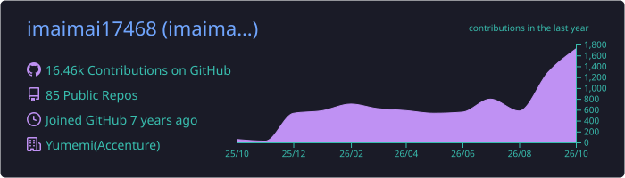
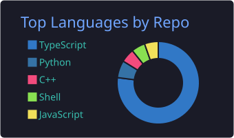
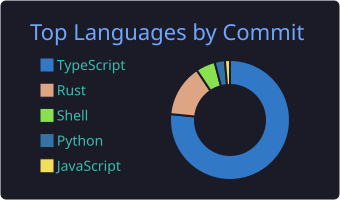
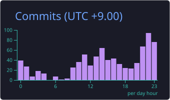
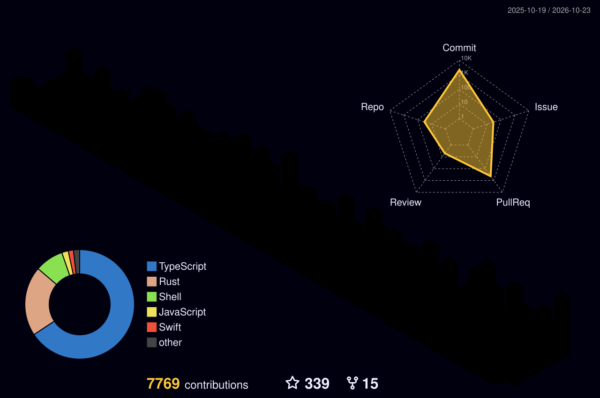

  
  
  
  
  
  

## 🐸 About me

- 🏢 Front-end Engineer at **Accenture Song (YUMEMI)**
- 🌐 Portfolio: [imaim.ai](https://imaim.ai)
- 🎨 UI / デザインシステム / 開発体験まわりのツールをよく作っています

## 🐸 Tech Stack

  

## 🐸 Featured Projects

  
  
  
  
  
  

## 🐸 GitHub Stats

  
  

  

  

  
  
  

## 🐸 Contributions

  

<picture>
  <source media="(prefers-color-scheme: dark)" srcset="./dist/github-snake-dark.svg" />
  
</picture>

## 🐸 Trophies

  

