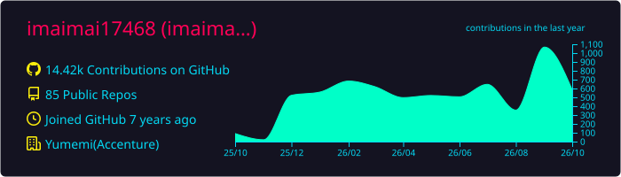
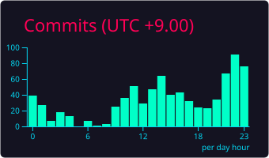

  

<h3 align="center">Front-end developer from Japan</h3>

<h3>connect with me:</h3>

- 🔭 I’m currently working on [Yumemi](https://www.yumemi.co.jp/)
- 📄 Know about my experiences [my portfolio](https://imaimai.tech/)
- [Note](https://note.com/imaimai17468/n/n4e86315e080d)

<h2 align="center">🐸 Activity 🐸</h3>

  
  

<h2 align="center">🐸 GitHub Stats 🐸</h3>

  
  

  

